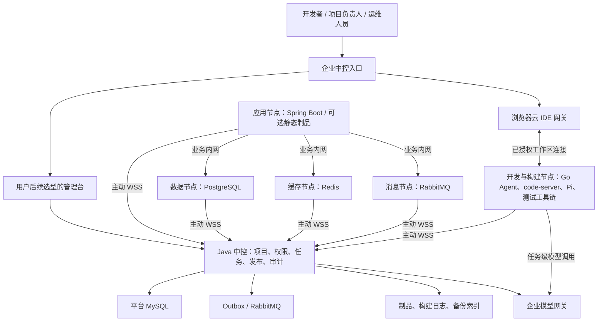

# 企业自托管 AI 软件工程平台详细开发计划

**规划日期** 2026-11-12　　**状态** 后端收口与详细规划；前端选型由项目负责人决定

技术决策见[后端技术栈与架构设计](20261112-后端技术栈与架构设计.md)。近期开发顺序见[现状盘点与下一轮开发计划](20261112-现状盘点与下一轮开发计划.md)。按[实施与验证记录](../logs/20261112-企业平台实施与验证.md)核对已运行的功能、测试拓扑与剩余验收项。实际部署从[工程工作台接入](../ops-manual/工程工作台接入.md)开始。

## 阶段实施计划

本轮以[现状盘点与近期队列](20261112-现状盘点与下一轮开发计划.md)、[后端技术栈与架构设计](20261112-后端技术栈与架构设计.md)、[后端接口与故障验收设计](20261112-后端接口与故障验收设计.md)作为研发交接入口。下列 M0–M4 文件保存长期目标、各阶段任务和退出条件。

- [M0-工程基线与开源治理](20261112-M0-工程基线与开源治理.md)
- [M1-中控与内网节点可靠作业](20261112-M1-中控与内网节点可靠作业.md)
- [M2-浏览器云IDE与AI编码工作流](20261112-M2-浏览器云IDE与AI编码工作流.md)
- [M3A-应用构建部署与回滚](20261112-M3A-应用构建部署与回滚.md)
- [M3B-中间件与日常运维](20261112-M3B-中间件与日常运维.md)
- [M4-企业稳定版与长期维护](20261112-M4-企业稳定版与长期维护.md)

## 1. 产品定位与交付标准

建设一套可以在 GitHub 公开发行、由企业独立部署和长期维护的软件工程平台。**一套中控管理多个项目、环境和服务器。开发者在浏览器里工作，AI 在授权范围内编写代码、测试、发布和维护，业务应用及中间件运行在企业指定的子服务器上。**

平台要对软件从需求到运行的整个过程负责。一条工程任务应能回答六个问题：谁提出了什么需求，AI 改了哪些代码，哪些测试实际通过，哪个制品部署到了哪些机器，发布后发生了什么，以及如何恢复到上一健康状态。

### 已确定的产品决策

| 事项 | 决策 |
|---|---|
| 使用方式 | 每家企业独立自托管一套中控，企业内支持多个团队、项目和环境 |
| 主要入口 | 浏览器管理台和浏览器云 IDE，开发者可直接编辑、运行、比较和审查代码 |
| 工程入口 | 同时支持从零新建项目、导入已有 GitHub 仓库 |
| 首批业务技术栈 | Java/Spring Boot 后端、PostgreSQL、Redis、RabbitMQ。前端由负责人另行选型 |
| 模型接入 | 企业配置自己的模型端点和凭据，支持云 API 或内网推理服务 |
| AI 自主程度 | 参考 ZCode，由用户在授权范围内选“变更前确认、自主模式、完全访问”，另设独立计划模式 |
| 首批基础设施 | 已提供的 Linux 主机或虚拟机，支持公网中控管理主动连接的内网节点 |
| 开源方式 | 团队非营利维护，自研部分沿用主仓 MIT，允许企业采用和商用，上游组件保留各自许可 |
| 排期方式 | 按依赖、优先级、工作量和验收结果推进，暂不承诺日历发布日期 |

### 用什么业务证明产品成立

使用一个持续维护的**订单系统参考项目**作为端到端回归工程。当前模板包含 Spring Boot API、PostgreSQL 订单数据、Redis 缓存和 RabbitMQ 订单事件。选择它的原因是一次普通需求就能同时覆盖 API、数据库、缓存、异步消息和发布，并预留任意客户端接入。

例如，用户在浏览器输入“为未发货订单增加取消功能”。平台最终应做到：

1. AI 找到订单状态、接口、页面、消息消费者和现有测试，提出修改计划。
2. 用户选择执行模式，AI 在独立任务分支修改代码并增加测试。
3. 用户能在浏览器查看差异、修改其中一部分、要求 AI 继续，自己的未提交改动得到保留。
4. 测试节点执行真实的单元和集成测试，包括重复取消、缓存更新、消息重复投递。
5. 合并后构建可追溯制品，先进入测试环境，再将同一份制品提升到生产。
6. 部署后出现错误时，界面能从告警定位到发布、提交、测试报告和负责节点。
7. 回滚后，发布前已有订单和发布后新产生的合法订单均可核验。涉及数据库结构变化时，按事先声明的数据兼容策略处理。

新建项目和导入已有项目都要走完这条链。它将成为产品每个稳定版本的回归用例。

---

## 2. 起始基线与改造顺序

下表记录制定长期路线时的仓库快照（提交 `8214c89`）。第 3 节至第 9 节描述目标架构与分期建设要求。当前工作树已新增工程域、项目 API 和执行器，逐项实现状态见文首的盘点与验收记录。

| 领域 | 起始资产 | 原定改造方向 |
|---|---|---|
| Java 中控 | 已有 Spring Boot、MySQL、Flyway V1–V37、认证、服务器管理、指标、告警、AI 诊断、审计和 RabbitMQ Outbox | 保留模块化单体架构，逐步增加项目、环境、工作区、工程任务、制品和发布模块 |
| Go Agent | 已有主动 WSS、心跳、断线重连、指标缓冲、终端和受限命令 | 增加节点能力登记、持久作业记录、回执重放、取消、状态对账和服务执行器 |
| 身份与授权 | 已有管理员、审核用户、节点凭据和一次性 Monitor Ticket | 增加项目成员、环境权限、节点分配、服务账号和短时工作区访问权 |
| 实时通信 | 已有 `/ws/agent` 和 `/ws/monitor`，当前节点会话与具体 JVM 绑定 | 保留已有通道兼容性，增加版本协商、可靠作业协议、可续读日志和云 IDE 反向通道 |
| 浏览器端 | 主仓尚无 `web/` 业务应用 | 规划管理台所需接口；浏览器编辑器复用 code-server，管理台框架待选 |
| AI | 已有运维问答、诊断、模型配置、命令模板和审批 | 新增独立编码运行时，统一模型出口、权限规则、运行预算和事件记录 |
| 部署与备份 | 已有平台自身的安装、升级、MySQL 备份与恢复脚本 | 新增管理**用户业务软件**的制品、版本切换、中间件模板、健康检查和恢复验证 |
| 开源工程 | 已有 MIT、组件 CI、CODEOWNERS、PR 模板和文档校验 | 补齐可复现发行、第三方许可、签名、软件物料清单、贡献与安全报告流程 |

有两处会直接影响开发顺序。第一，现有节点登记要求 SSH 信息，内网节点接入必须增加只靠注册令牌的路径。第二，当前命令通道在节点执行完毕但回执丢失时，缺少发布所需的持久对账能力。因此，**第一个研发重点是让一项远程作业可以安全完成、断线恢复、查清结果**。已有监控、终端和 Android 客户端要作为兼容性回归对象。[现有架构](../tech-summary/architecture.md) · [现有 WebSocket 协议](../protocol/websocket-protocol.md) · [现有命令协议](../protocol/command-protocol-v1.md)

## 3. 总体架构与服务器分工

### 3.1 中控服务器

中控负责企业身份、项目授权、节点目录、任务调度、模型配置、发布历史、审批、审计和恢复。首版沿用 Java 模块化单体，降低部署和调试成本。调度器、模型网关和工作区网关各有清晰接口，日后可以根据资源消耗拆为独立进程。

平台元数据库继续使用现有 MySQL。业务系统可以使用 PostgreSQL。两者分别拥有账号、备份、升级和恢复流程。RabbitMQ 用于事件传递和唤醒消费者，MySQL 保存作业与发布的权威状态。中控重启后能够从数据库重建待处理任务。

### 3.2 开发与构建节点

开发节点承载浏览器 IDE、代码检出、AI 编码、依赖安装、构建和测试。节点登记时报告 CPU 架构、可用内存、持久卷、工具链和隔离能力。调度器按任务要求选节点，例如需要 ARM64 原生依赖的构建应落到相应架构或经过验证的构建环境。

人类工作区和 AI 任务各有独立可写目录。中控统一保管长期 Git 和模型凭据，工作区仅取得当前任务所需的短时授权。仓库里的构建脚本、依赖安装和 IDE 扩展均在工作区权限内执行。

### 3.3 应用与中间件节点

同一节点可以承担多个角色，也可以按企业实际拓扑分机部署。企业能明确表达“订单 API 在 A，PostgreSQL 在 B，Redis 在 C，RabbitMQ 在 D”。平台记录每个服务的目标节点、端口、版本、持久数据、依赖关系和健康检查。

**中控链路和业务链路分别验收。** 所有节点都能连上中控，只能证明管理链路可用。应用节点还必须能通过业务网络连接数据库、缓存和消息队列。发布前由应用所在节点验证 DNS、连通性和应用级认证。中控短时离线期间，已上线的业务继续按原有拓扑工作。

### 3.4 制品和大文件

首轮双机联调用中控独立持久目录保存制品，通过受鉴权的 HTTPS 上传和下载。企业版提供兼容 S3 的对象存储后端，供多实例中控共享。数据库只保存对象引用、摘要、大小、来源、保留策略和校验状态。

控制帧、IDE 流量、构建日志、制品下载分开限流。大日志和制品不塞入现有的 Agent 控制帧，避免一次前端构建占满通道后，心跳、取消或发布回执无法及时送达。

## 4. 核心业务对象与接口

### 4.1 领域模型

| 对象 | 记录什么 | 关键约束 |
|---|---|---|
| 项目、成员、环境 | 仓库归属、团队角色、开发/测试/生产环境和授权 | 用户可在同一项目开发，生产发布另行授权 |
| 节点、节点能力、节点分配 | 身份、在线状态、架构、工具链、允许服务的项目与环境 | 注册成功后仍需分配用途 |
| 仓库连接 | GitHub 安装身份、具体仓库、默认分支、允许操作 | 支持按仓库撤销访问 |
| 工作区 | 所有者、项目、节点、持久卷、工作分支、最后活动时间 | 休眠保留代码，删除有未提交改动的工作区需要明确提示 |
| 工程任务、运行、步骤 | 原始需求、基准提交、当前步骤、审批、重试及最终结果 | 一项任务可以多次运行，各次结果分别保留 |
| 节点作业 | 目标、动作版本、参数摘要、执行代次、截止时间、执行证据 | 同一作业重复送达可查回原结果 |
| 服务与服务实例 | 服务类型、期望版本、实际版本、依赖、配置引用、健康状态 | 共同表达项目期望状态与节点实际状态 |
| 制品 | Git SHA、构建记录、目标架构、文件摘要、依赖清单 | 已发布制品按摘要不可变 |
| 发布与部署批次 | 目标环境、制品、配置版本、节点、健康检查和回滚点 | 同一环境的同一服务有序发布 |
| 审批与审计 | 发起人、用户模式、授权范围、审批人、动作、对象和结果 | 审批绑定具体变更，后续改包或换目标需要重新判定 |
| 备份与恢复记录 | 对象、版本、时间点、存储位置、校验值、演练结果 | “备份生成”和“恢复验证成功”是两个独立状态 |

数据库迁移只新增 Flyway 版本。已有节点先归入可审查的迁移项目，由管理员完成成员和环境分配。新旧 REST、WebSocket 和 Android 访问入口共用同一套资源授权，避免管理台收紧权限后，旧接口仍可跨项目读取。

### 4.2 对外接口分工

| 接口 | 首批能力 |
|---|---|
| 管理 REST API | 项目、成员、环境、仓库接入、工作区创建/休眠、任务运行/取消、审批、制品、发布/回滚、备份/恢复 |
| 浏览器事件流 | 按任务或发布订阅，持续接收步骤、日志、审批请求和最终结果。重连时携带游标补读 |
| Agent 作业协议 | 声明能力、接收作业、持久化确认、报告进度、回传结果、确认收讫、取消、重连对账 |
| 云 IDE 网关 | 校验工作区成员和会话，转发该工作区的 HTTP 与 WebSocket，权限撤销时关闭既有连接 |
| GitHub 集成 | 按仓库授权、导入、新建、推送任务分支、创建 PR、接收变更和合并结果 |
| 模型网关 | 按项目指定模型、凭据、允许发送的源码范围、预算和超时，记录调用与所属任务 |

首批新增资源采用项目作用域，例如 `projects/{id}/workspaces`、`projects/{id}/runs` 和 `projects/{id}/environments/{env}/releases`。外部发起运行、创建发布和请求回滚都支持幂等请求。API 契约和浏览器类型同步生成，另外增加权限与字段语义测试。当前仓库的契约检查主要验证路径和引用，不能覆盖资源归属与运行行为。[现有 OpenAPI 说明](../openapi/README.md)

### 4.3 项目部署清单

在项目仓库引入版本化的 `cloide.yaml`。新项目由模板生成，导入项目由平台扫描后生成草案，用户确认后纳入 Git。首版清单覆盖：

- 服务列表、源码目录、构建方式、测试入口和制品类型。
- Java API、可选静态站点、数据库、缓存和消息队列之间的依赖关系。
- 服务的端口、健康检查、启动顺序、配置项和密钥引用。
- 发布策略、旧版本保留、数据库迁移步骤和回滚相容性。
- 中间件持久卷、备份策略及恢复验证方式。

具体机器、生产凭据和模型密钥由企业在中控绑定。仓库清单可以声明“需要 PostgreSQL 连接”，生产库口令留在企业凭据系统。用户在 PR 中修改部署清单时，平台显示本次变化会影响哪些服务、配置和发布步骤。

## 5. AI 编程、云 IDE 与开源复用

### 5.1 各个上游项目用在哪里

| 上游 | 具体采用内容 | 验证条件 |
|---|---|---|
| **Pi** | 首版嵌入 TypeScript SDK，使用 `createAgentSession`、会话事件订阅、取消、受控资源加载、自定义工具。每项任务有独立会话、工作树和预算 | 能在指定目录读写、取消、恢复，展示真实差异和测试结果；任务结束能清理进程与临时授权 |
| **ZCode** | 复用三档自主程度、独立计划开关、单次确认和恢复时显示原选择的交互。其 Web 版的会话、文件树和差异审阅可作为产品设计依据 | 浏览器、后台任务和恢复入口执行相同授权规则，界面能说明“一次请求为什么自动执行或为什么要确认” |
| **code-server** | 提供浏览器编辑、终端、文件管理、Git 差异和扩展能力。平台负责创建实例、鉴权、持久卷、休眠与撤权 | 从管理台一键进入指定工作区，编辑和终端仅访问该工作区，关闭浏览器后后台任务继续 |
| **IntelliJ Community** | 使用 Standalone Analysis 的平台及 Java PSI，在独立进程中提供查类、定位方法、解析符号和源码跳转 | 固定上游版本后，用真实多模块 Spring Boot 工程测正确率、冷启动和内存。索引异常时仍能通过文本搜索和编译器诊断完成任务 |
| **OpenCode** | 作为第二编码引擎候选，先用首版统一的启动、事件、取消、恢复语义做适配测试 | 替换引擎时仍能执行同一套授权、仓库隔离和验收用例 |
| **DeepSeek Harness、ZCode Plugins** | 列入后续扩展。插件按来源、版本和申请能力登记，企业管理员选择启用 | 上游版本可复现、权限范围清楚、发行材料齐备后再纳入支持目录 |

`harness/` 和 `ide/` 是主仓忽略的本地上游副本。正式构建必须依靠可追溯的官方依赖或固定源码版本。自研代码只维护适配层和必要补丁，记录上游提交、补丁用途、许可证、NOTICE 和升级测试。IntelliJ 的 Java 分析按工作区隔离进程，因为它的 `Application` 存在进程级单例约束。ZCode 的第三方清单也有待补齐项目，实际分发哪些组件，就核对哪些组件。[Pi 上游](https://pi.dev/) · [ZCode 源码](https://github.com/zai-org/ZCode) · [code-server 上游](https://github.com/coder/code-server) · [IntelliJ Community](https://github.com/JetBrains/intellij-community)

### 5.2 用户在浏览器里实际看到什么

| 页面 | 用户能完成的事 |
|---|---|
| 项目概览 | 看仓库、环境、最近发布、正在运行的任务、异常服务和责任人 |
| 服务拓扑 | 看服务在哪台机器、依赖谁、当前版本、期望版本、健康状态，定位哪条依赖异常 |
| 云 IDE | 编辑代码、打开终端、运行测试、发起 AI 任务、看差异、接受或修改结果 |
| 任务详情 | 看原始需求、计划、工具动作、等待审批项、测试报告、变更文件和 PR |
| 发布中心 | 比较当前版与待发布版，选择环境、检查迁移、观察节点进度、回滚 |
| 节点管理 | 登记、分组、分配角色、看能力、排空任务、轮换凭据、升级 Agent |
| 中间件与备份 | 安装实例、查看配置差异、执行备份、恢复到新实例、核对业务读写 |
| 企业设置与审计 | 管理团队、模型、GitHub、权限、保留策略，按人、项目、节点和发布检索操作 |

首版设计上要能让三类用户独立工作。开发者从需求进入代码和测试，运维从拓扑进入发布和恢复，负责人从审批看到**将要改变的具体对象、版本和影响范围**。

### 5.3 AI 运行规则

1. 任务创建时固定项目、环境、基准 SHA、用户模式、模型配置和工作树。子任务继承相同或更窄的权限。
2. 编码运行时显式装配可用工具，包括读取仓库、查询符号、应用补丁、运行项目测试、生成差异和提出发布申请。通过受管资源加载器控制仓库扩展和 MCP 工具的加载。
3. 开发者和 AI 分开写入。用户继续编辑时，AI 基于自己的任务分支推进。合并时检查基准提交、文件变化和冲突，允许用户在 IDE 内解决。
4. 企业可按项目设置源码可发送范围、模型地址、单次运行预算、超时和最大修复轮次。外部模型中断时展示已完成步骤、用量和可恢复位置。
5. AI 报告“已完成”只代表模型结束该轮。平台依据实际 Git 差异、测试进程退出码、测试报告、制品摘要和部署回执判定工程状态。
6. 人工停止任务后，平台取消待执行步骤，通知运行节点清理进程树；如果某一步已经产生外部效果，任务页展示实际结果和剩余恢复动作。

### 5.4 权限矩阵

| 模式 | 工作区内读代码、查状态 | 修改代码、执行测试 | 发布、维护与数据操作 |
|---|---|---|---|
| **计划模式** | 按已授权范围自动读取 | 生成拟变更清单 | 生成目标、影响和恢复方案 |
| **变更前确认** | 自动 | 对具体变更或明确列出的执行动作请求确认 | 展示环境、制品、影响节点和恢复说明，请求确认 |
| **自主模式** | 自动 | 授权内的日常编辑和测试自动执行 | 已授权常规动作自动，命中企业风险规则时单次确认 |
| **完全访问** | 自动 | 在任务范围内自动执行 | 企业明确允许免确认的发布和运维动作自动执行，企业保留的审批规则继续生效 |

授权按**用户 → 项目 → 环境 → 节点/服务 → 动作**逐层收敛。例如开发者可以对自己的任务工作区选择完全访问，同时只有读取生产日志的权限。一次生产审批绑定制品摘要、目标环境、配置版本和有效期。审批后若换包、换节点或修改迁移步骤，平台重新计算授权。

所有入口显式传递模式，缺省回到“变更前确认”。这点尤其重要，本地 ZCode 的某些无头或旧任务恢复路径会回退到 `yolo`。现有旧命令域继续遵守原有模板规则，新发布能力通过独立作业动作接入。[ZCode 上游](https://github.com/zai-org/ZCode) · [现有命令域规则](../protocol/ai-command-m3-gate-review.md)

## 6. 可靠作业、发布与故障恢复

### 6.1 一项节点作业怎样执行

1. 中控校验权限，创建作业，记录稳定作业 ID、目标节点、动作版本、参数摘要和截止时间。作业与 Outbox 事件同事务提交。
2. 调度器取得执行租约，根据节点连接和能力发出作业。节点先写本地持久记录，再确认接收。
3. 同一 ID 和同一参数摘要再次到达时，节点返回现有进度或原结果。同一 ID 携带不同参数时拒绝执行并记录冲突。
4. 节点按步骤写入开始、进度、实际效果和结束状态。中控收到最终回执并持久化后，通知节点该回执可按保留策略清理。
5. 节点重连时，双方对账正在执行、已完成未确认、已取消和待核实作业。消息队列恢复后由数据库扫描补调遗漏任务。
6. 若进程在“外部效果已发生，本地结果还没写入”之间崩溃，节点检查实际版本、进程状态或数据库迁移记录。能够证明结果就补记；证据不足就进入**待核实**，由负责人判断下一步。

任务状态至少区分排队、运行、待审批、取消中、已取消、失败、成功和待核实。网页能区分“节点离线”“命令失败”“执行结果还未知”，避免值班人员因为看到笼统的失败提示而重复执行。

### 6.2 一次应用发布怎样执行

| 步骤 | 动作 | 必须留下的证据 |
|---|---|---|
| 构建 | 从已确认提交执行构建与测试，生成 Java 包、前端静态资源及发布描述 | 提交 SHA、工具链、测试报告、制品摘要 |
| 预检 | 检查节点能力、磁盘、端口、依赖连通性、配置、迁移条件和上一健康版本 | 目标清单、实际结果、配置摘要 |
| 分发 | 节点下载制品，校验签名及摘要，写入独立版本目录 | 下载结果、校验结果、版本目录 |
| 启动 | 在候选端口或独立实例启动新版本，执行存活、就绪及业务探针 | 进程信息、探针响应、业务样本 |
| 切换 | 按发布批次切流，分别处理 HTTP 服务与后台消费者 | 实际流量目标、消费者版本、切换时间 |
| 观察 | 监控错误率、响应延迟、消息积压和关键交易 | 发布前后观测窗口、异常及归属实例 |
| 完成或回滚 | 保留成功版本，失败时切回上一健康版本并保留现场 | 成功或回滚证据、仍需处理的数据变更 |

同一环境、同一服务的发布串行执行。旧调度器恢复后须检查当前发布代次，避免过期任务覆盖新版本。多节点发布逐个记账，部分成功时准确展示各节点实际版本。

数据库迁移采用先扩展、再升级应用、最后收缩旧结构的顺序。涉及删除或不可逆转换的数据另行定义备份与恢复步骤。发布后已经产生新订单时，回滚应用优先保证新数据可读，数据库整库恢复由独立流程处理。

### 6.3 三类中间件如何真正纳管

| 服务 | 首批交付 | 恢复验收 |
|---|---|---|
| **PostgreSQL** | 固定受支持版本，创建独立数据目录、业务库、角色和权限，配置连接检查、容量告警、备份与升级前检查 | 将逻辑备份恢复到独立实例，核对角色、约束、记录和应用读写。需要时间点恢复的生产配置增加基础备份与 WAL 归档，并实测恢复到指定事务附近。[PostgreSQL 恢复机制](https://www.postgresql.org/docs/current/continuous-archiving.html) |
| **Redis** | 明确实例用途、认证、内存上限、淘汰策略和持久化配置。业务缓存与需要持久保存的数据采用不同模板参数 | 缓存型实例验证冷启动重建和应用回源；持久型实例恢复 RDB/AOF 后核对业务键、TTL 和约定的数据丢失窗口。[Redis 持久化说明](https://redis.io/docs/latest/operate/oss_and_stack/management/persistence/) |
| **RabbitMQ** | 管理 vhost、用户、权限、交换机、队列、绑定、死信配置和消费者健康 | 分别验证拓扑恢复和业务消息恢复。用一批有业务 ID 的消息核对发布确认、消费确认、重投和去重。导出 definitions 只覆盖定义，消息恢复需额外验证。[RabbitMQ 备份说明](https://www.rabbitmq.com/docs/backup) |

三个模板共用版本固定、执行前差异、健康检查、备份索引、恢复到新实例、验证和审计框架。每种中间件自己的数据语义由单独适配器负责。首个稳定版支持独立实例的完整生命周期，后续再分别交付 PostgreSQL 主备、Redis 高可用和 RabbitMQ 仲裁队列集群，并为每种拓扑安排独立故障域验收。

### 6.4 维护闭环

告警页面展示关联服务、节点、当前发布和最近变更。AI 可读取授权范围内的指标、脱敏日志和发布记录，给出诊断理由及处理方案。处理动作分两条：

- **运行时恢复**适用于回到上一健康版、重启指定无状态实例、恢复预先登记的配置等操作。平台执行固定动作，验证业务探针并关联原告警。
- **代码修复**适用于逻辑错误、数据兼容问题和重复消费等缺陷。平台从实际运行版本创建修复任务，写回归测试，经正常交付链重新发布。

同一故障的自动修复设次数和时间预算。连续失败或证据不足时，平台保留现场、停止重复尝试，并把已经做过的动作交给值班人员。

## 7. 分阶段工作包、依赖与工作量

以下是按当前范围给出的**工程估算**，单位为人周，包含实现、联调、回归和相应文档。工作量会随第一轮 ARM64、云 IDE 和现有代码兼容性实测调整，不直接换算成发布日期。

| 阶段 | 优先级 | 工作量 | 可交付成果 | 退出条件 |
|---|---|---:|---|---|
| **M0 工程基线** | 首先开展 | 3–5 | 长期项目定位、架构决策、依赖来源、干净构建和两机测试约定 | 新环境能复现基础构建，旧功能有新的回归记录 |
| **M1 中控与可靠节点作业** | 关键路径 | 10–16 | 项目/环境授权、令牌登记、作业、实时日志、取消和对账 | 两机实际跑通一次远程测试；丢回执后恢复原结果 |
| **M2 云 IDE 与 AI 开发** | 依赖 M1 作业和权限契约 | 16–26 | 新建/导入、浏览器 IDE、Pi、权限模式、测试与 PR | 两种工程入口都能交付可审查、可复现的变更 |
| **M3A 应用持续交付** | 依赖 M1，和 M2 后半段可并行 | 10–16 | 制品、环境提升、候选部署、切换、健康回滚、发布中心 | 同一制品走完测试和生产；坏版本自动恢复 |
| **M3B 中间件与值班维护** | 依赖 M1 和发布执行框架 | 12–22 | 三种服务模板、备份恢复、告警关联、运行时和代码修复 | 三种中间件各完成一次可验证恢复，告警可追溯到解决动作 |
| **M4 企业稳定发行** | 依赖完整业务链 | 18–32 | 企业 SSO、密钥轮换、审计导出、控制面恢复与多实例接管、版本化发行 | 从干净机器安装、从旧版升级、从备份恢复和真实跨机故障验收全部留证 |

**累计估算为 69–117 人周。** 第一套可给内部团队试用的“浏览器开发 → AI 改码 → 测试 → 发布 → 回滚”在 M3A 结束时交付。企业稳定版另行完成中间件恢复、权限、控制面故障接管和公开发行验收。

### M0 · 工程基线

1. 调整 README、仓库总纲和开发流程，把项目目标改为长期自托管企业软件，整理历史材料归档位置。
2. 建立三份架构决策：中控与节点角色，工程作业与旧命令协议的边界，开源组件与许可证策略。
3. 单独处理现有后端迁移期约束。固定实际支持的 Java、Spring Boot、Go、Node 和数据库组合，验证旧库升级、旧客户端和契约生成。
4. 在临时干净环境完成一次全新检出，证明编译不依赖本机 `harness/` 或 `ide/`。
5. 建立第三方依赖登记表，明确哪些作为依赖下载、哪些随发行包附带、哪些仅作参考。
6. 将两台测试机的资源、持久路径、已有进程和独立测试目录核验步骤写入内部联调手册。公开文档使用参数化示例。

### M1 · 中控与节点

1. 增加项目、环境、成员和节点分配，先把读权限、开发任务权限和生产发布权限分开。
2. 实现一次性令牌登记和节点凭据轮换，保留旧节点接入路径。
3. Java 与 Go 共同冻结作业信封、能力协商、日志分段、最终回执和重连对账契约。
4. 实现中控作业表、步骤表、事务事件、调度租约和环境级串行化。
5. 实现 Go 节点持久执行记录，处理重复送达、断线、进程重启、磁盘写满和取消。
6. 交付项目范围的选节点、能力、创建运行、续读日志及查询终态 API。管理台由负责人选型后开发。
7. 在两机上故意丢失一次终态回执，证明测试没有被重复运行。

### M2 · 浏览器开发与 AI

1. 接入 GitHub App，以仓库安装权限完成新建、导入、分支、PR 和 webhook 处理。重复 webhook 按事件 ID 去重。[GitHub App 授权机制](https://docs.github.com/en/apps/creating-github-apps/about-creating-github-apps/about-creating-github-apps)
2. 交付 Java + 业务中间件项目模板，包含测试、健康检查、部署清单和本地开发说明。
3. 对已有项目识别模块和构建入口。对不能可靠识别的模块，让用户在导入界面指定；保存后可重复执行。
4. 接入 code-server 工作区生命周期，包括创建、打开、休眠、恢复、撤权和删除。
5. 接入 Pi 会话，完成受控工具、代码差异、取消、断线续看和测试证据收集。
6. 实现 ZCode 式模式选择，覆盖会话创建、任务恢复、子任务继承、权限撤销和审批过期。
7. 用 IntelliJ Standalone Analysis 验证 Java 类、方法和依赖解析，输出可跳转的文件、行号和对应提交。
8. 跑通订单系统需求，同时验收 AI 和开发者并发改同一文件，以及任务期间目标分支已前移的情况。

### M3A · 应用交付

1. 建立不可变制品、构建报告、签名和摘要校验。
2. 为 Java 包和 通用静态制品分别实现部署动作，支持版本目录和健康切换。
3. 实现环境配置与密钥引用，让同一制品可在不同环境运行。
4. 实现迁移预检、兼容窗口、发布锁、暂停、逐节点状态和回滚。
5. 建立发布中心，支持从发布查看代码差异，从提交反查部署环境。
6. 完成好版本 → 坏版本 → 回滚的实测，核对用户请求、后台消费者和业务数据。

### M3B · 中间件与运维

1. 先交付 PostgreSQL，从安装到备份再到新实例恢复，打通第一个有状态服务全流程。
2. 交付 Redis 的缓存型与持久型配置和恢复验证。
3. 交付 RabbitMQ 拓扑、账户权限、消息验证和业务重放流程。
4. 把三种服务纳入项目拓扑、容量告警、版本盘点和升级前检查。
5. 告警关联最近发布，AI 生成可审查的诊断和修复任务。
6. 记录每次演练的恢复时间、实际可恢复时间点、核对数据和操作者。

### M4 · 企业稳定发行

1. 支持企业 OIDC 单点登录，映射团队与项目角色，并保留可审计的管理员恢复路径。
2. 增加节点排空、滚动升级、稳定版兼容窗口、任务配额和存储保留策略。
3. 增加模型、Git、数据库和节点凭据轮换；验证撤权对运行中会话生效。
4. 完成多实例中控的连接归属、调度租约、工作区路由和故障接管。
5. 从干净机器恢复中控数据库、制品索引、对象、密钥材料和节点关联。恢复后先对账再开放新派发。
6. 建立 GitHub Releases、amd64/arm64 安装包、签名与校验、升级说明、支持矩阵、贡献指南、漏洞报告渠道及维护者职责。

## 8. 两台现有服务器的具体验收方案

| 机器 | 已知情况 | 首轮用途 |
|---|---|---|
| 云中控测试节点 | 规划期只读探测为 x86_64、2 核、约 3.6 GiB 内存，运行 systemd | 中控、HTTPS/WSS 入口、调度和最小持久存储。编译与代码索引放到子节点 |
| 内网测试节点 | ARM64，PID 1 为 `tini`，未发现 Docker/Podman 命令。临时 `bwrap` 用户、PID、网络命名空间探测成功 | 首个开发、构建与业务测试节点。用独立测试用户、持久目录、端口、凭据和受控进程运行 |

第一轮按以下顺序验收：

1. **能力登记。** 从内网节点主动连中控。管理台看到架构、工具链、磁盘、工作区能力和在线状态。服务器 SSH 别名只用于本次环境准备与排查。
2. **工作区持久性。** 用实际运行用户创建测试文件，结束并恢复工作区，验证文件、权限和 Git 状态。分别测试卷不可写、磁盘空间不足和任务进程回收。
3. **真实构建。** 节点检出固定提交，执行一次 Maven 或前端测试，把实际日志、退出码和报告传回中控。
4. **断线与恢复。** 在接单后、测试过程中、测试完成但回执未确认三个时点分别断开测试 Agent，核对同一作业的恢复结果。
5. **浏览器开发。** 从中控打开内网工作区，编辑、保存、运行测试。撤销用户权限，验证已经建立的 IDE 与终端连接也关闭。
6. **AI 变更。** AI 在独立工作树完成一次可审查修改。模型服务中断时保留已有改动，恢复后从同一任务继续。
7. **应用部署。** 在独立目录和端口运行参考应用，部署一个健康版本，再部署一个故意无法就绪的版本，核验切换与回滚。
8. **数据恢复。** 使用测试数据对 PostgreSQL、Redis、RabbitMQ 分别演练。恢复目标为新建实例，核对完成后再测试切换。
9. **清理。** 结束本轮的工作区、临时服务、代理连接和子进程，核对占用端口及测试资源。需要长期运行的正式安装另行登记。

`bwrap` 探测证明了指定命名空间可以创建。低权限用户的持久卷、资源限额、网络策略和完整进程树回收仍要单独实测。如果盒子无法提供工作区所需的隔离条件，首轮仅用受控参考工程验证，并将通用仓库构建转移到具备隔离能力的独立开发节点。

**两机环境可以证明完整软件链路，真正的多机拓扑另设验收。** 当需要验证“应用节点正常但数据库节点断开”、中控实例接管、跨机网络分区或中间件集群仲裁时，增加独立故障域。发布说明明确标识每项能力采用的实际测试拓扑。

## 9. 测试、质量与公开发行

### 9.1 发布前必须覆盖的故障场景

| 场景 | 预期结果 |
|---|---|
| 中控在派发前重启 | 作业仍在数据库，恢复后可以继续调度 |
| 节点已执行，终态回执丢失 | 重连后查询原结果，实际部署和迁移各只发生一次 |
| 节点执行到一半崩溃 | 能核实的步骤按事实恢复；不确定的外部效果进入待核实 |
| RabbitMQ 暂时不可用 | 事务记录保留，恢复后补发，页面显示积压情况 |
| 同一服务同时请求两个版本 | 变更有序，旧任务恢复后不能覆盖新版 |
| 制品被损坏或架构不符 | 预检或摘要校验失败，现运行版本继续服务 |
| 用户批准后制品或目标改变 | 原审批失效，重新判定新变更 |
| 用户撤权，工作区仍开着 | 现有连接被关闭，后续写入、发布或恢复动作被拒绝 |
| AI 和开发者同时编辑同一处 | 保留两份改动，通过 Git 差异解决，界面不报告虚假成功 |
| 健康检查通过，关键业务探针失败 | 候选版本不完成发布，保留业务失败证据 |
| 数据库已迁移后应用回滚 | 验证旧应用仍能读取兼容结构和上线后的业务数据 |
| 从备份重建中控 | 能解密必要材料、找到原制品、认领节点，完成对账后恢复调度 |

### 9.2 测试分层

- **组件测试。** Java 验证授权、状态机、事务和接口；Go 验证节点持久记录、作业去重、取消和恢复；Web 验证关键操作与错误状态；AI 适配器用确定性模拟模型覆盖工具调用和审批。
- **契约测试。** 对 REST、Agent 作业帧、浏览器事件和制品描述做跨语言校验，覆盖未知字段、版本协商、旧 Agent 接入和错误码。
- **集成测试。** 使用真实数据库、消息队列、Git 仓库和构建工具，验证迁移、事件可靠性、制品校验和健康切换。
- **端到端测试。** 通过浏览器完成新建、导入、AI 修改、测试、PR、发布和回滚。真实模型端点单独跑验收，记录模型、预算、实际结果和人工介入点。
- **性能与容量。** 记录节点连接数、排队延迟、日志吞吐、工作区冷启动、Java 索引峰值、构建资源、发布耗时。按实际硬件形成支持矩阵。
- **恢复演练。** 每个稳定版记录实测恢复时间和数据恢复点，报告采用的数据量、拓扑和版本。备份成功率与恢复成功率分别统计。

### 9.3 GitHub 公开版应交付什么

正式版本包括源码、发行说明、校验与签名、第三方声明、软件物料清单、两种架构的已验证安装方式、最小配置、管理员手册、开发者手册、备份恢复手册、升级与回滚说明，以及已知限制。新安装、从上一稳定版升级、从备份恢复是三条不同的发行验收路径。

继续采用现有 `preview` 集成、`main` 发布的协作方式。每个功能 PR 应说明用户行为变化、数据迁移、兼容影响、测试证据和恢复办法。公开前盘点仓库及历史中的实际域名、环境标识和凭据；如发现真实凭据，按凭据轮换处理。

## 10. 第一批开发任务与完成定义

为了让后续开发马上有入口，首批工作按以下顺序进入任务列表：

| 顺序 | 开发任务 | 可审查交付物 |
|---|---|---|
| 1 | 更新项目定位和总架构 | 中文总体规划、架构图、决策记录、长期维护范围 |
| 2 | 固定构建与回归基线 | 干净检出构建结果、现有三端回归记录、上游依赖清单 |
| 3 | 新增项目、环境、成员和节点分配 | 数据迁移、REST 契约、权限用例、旧节点迁移说明 |
| 4 | 实现无 SSH 凭据节点登记 | 一次性登记、轮换、撤销、旧 Agent 兼容用例 |
| 5 | 建立可靠作业协议 | Java/Go 共同契约、状态机、持久确认与重连对账用例 |
| 6 | 实现“检出指定提交并执行测试” | 中控派发、节点执行、真实日志、报告、取消和回执 |
| 7 | 冻结未来客户端所需 API 与错误语义 | 登录、选项目、选节点、发起任务、查看日志与结果 |
| 8 | 在现有两机完成故障验收 | 同一次作业在断线、重连、中控重启后的完整证据 |
| 9 | 接入首个浏览器工作区 | 打开、编辑、测试、休眠、恢复与撤权记录 |
| 10 | 接入首个 Pi 编码任务 | 需求、计划、权限模式、差异、真实测试与 PR 的关联记录 |

**第一个里程碑按这个操作验收：用户在浏览器选择仓库和提交，中控指派内网节点运行测试。测试完成后故意丢弃一次回执，重连页面仍能展示同一次执行的真实报告，并能证明节点只执行了一次。** 完成这一步后，Pi 写代码、浏览器 IDE、应用部署和中间件维护都可以复用同一套节点执行、权限、实时反馈和恢复机制。

计划按人周估算。阶段是否交付，以对应版本的实现、测试报告与恢复演练记录为准。
