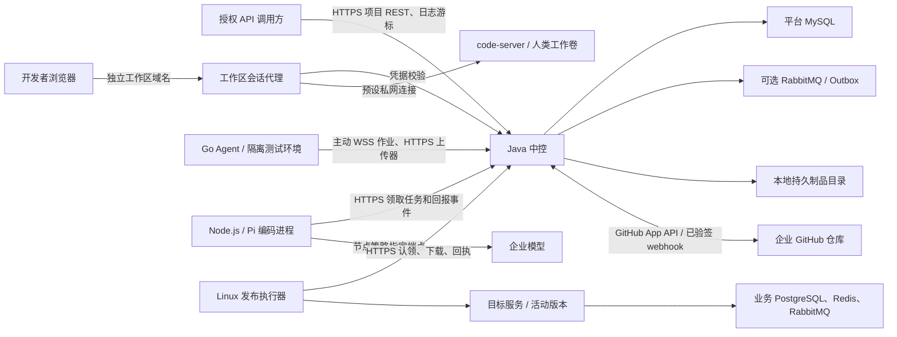

# Cloide 企业自托管软件工程平台架构

截至 2026-11-12，企业可以在一套 Java 中控登记多个项目、环境和 Linux 节点。本轮以项目 REST API、节点协议和后端测试为交付入口。平台管理台的框架由项目负责人另行选定，早期临时浏览器客户端的实测保留在验收日志中。工作区网关可直接对接 code-server，测试、AI 编码和业务部署在各自授权的节点执行。Android 继续提供监控、告警和终端入口。本文描述仓库当前实现与验收范围。阶段目标和排期见[总体规划](../plans/20261112-企业自托管AI软件工程平台总体规划.md)与[下一轮开发计划](../plans/20261112-现状盘点与下一轮开发计划.md)。

## 一项任务经过哪些进程

节点角色可以分机，也可以在同一主机用独立身份运行。中控维护项目授权、任务状态和制品索引。业务请求直接在应用和它的中间件之间传递，业务网络、应用账号及其恢复目标由安装方配置。节点能连到中控后，仍须从应用节点验证到每个业务依赖的连通性和读写结果。[工程 API 接入](../ops-manual/工程工作台接入.md) · [订单参考工程](../../examples/orders/README.md)

| 环节 | 数据和状态怎样传递 | 目前的交接点 |
|---|---|---|
| 1. 仓库进入项目 | 平台管理员通过 GitHub App 导入组织仓库或从指定模板创建私有仓库。中控保存项目、远端仓库 ID、installation ID、仓库名和默认分支。 | 企业配置 App、模板、权限和 webhook。节点管理员维护只读 Git 对象库、Pi 的受信任分支及人类工作卷。仓库登记尚未自动同步上述三个目录。通过 API 发起编码和测试时使用仓库别名与完整提交 SHA。[GitHub 接入](../ops/github-app-repositories.md) |
| 2. 人在 IDE 开发 | 浏览器从中控取得一次性工作区票据，工作区域名兑换自己的会话。会话代理验证身份，再将 HTTP 和 WebSocket 转到该实例。工作区节点领取期望运行状态、回报观测状态及代次。 | 管理员预设所有者、节点、域名、证书、私网映射、工作树和持久卷。受管实例可休眠、唤醒和撤权，原有手工托管实例仍使用企业进程管理器。[工作区部署](../../deploy/workspace/README.md) |
| 3. AI 改动与审查 | 中控记录需求、基准 SHA 和权限模式。Pi 节点按项目和仓库领取任务，从已授权文件生成独立任务工作树，回传计划、审批、内容摘要、差异和状态。调用方通过项目编码任务的详情、事件和审批接口审查变更。创建 PR 时，中控核对基准提交和文件摘要，再用 GitHub API 创建任务分支与 PR。 | 模型地址、凭据文件、文件清单和强制审批项由节点策略指定。计划模式只读。任务进入 `ready_for_review` 后仍需另行测试。GitHub 合并 webhook 更新 PR 状态，合并后选定实际提交并触发节点构建的步骤仍需衔接。[编码节点](../../worker/README.md) · [仓库契约](../openapi/openapi-repository.json) |
| 4. 实际测试与制品 | Go Agent 在已认证的 WSS 通道报告能力、接收含项目、作业号、仓库和 SHA 的信封。作业先记入节点账本，再在非 root 离线沙箱检出固定提交，执行登记命令，回传日志、退出码和持久终态。作业日志接口按序号游标返回分段输出。 | 管理员准备本地裸仓库、工具链、测试命令和可选制品类型。构建把结果写入指定输出，由同一节点的 HTTPS 上传器提交。中控复核作业、来源节点及摘要，支持丢回执后的同作业重传。人工上传另存来源。[作业协议](../protocol/node-jobs-v1.md) |
| 5. 提升、部署与恢复 | 中控按项目、环境、服务记录发布意图和代次。固定目标的 Linux 执行器认领后下载制品、校验 SHA-256 与分离签名、切换版本并运行探针，将节点的实际结果落盘回报。生产提升要求管理员授权、真实构建节点来源和同一制品在测试环境该服务的健康记录。 | 企业准备签名、公钥、探针、静态站点或 Java 用户级 systemd 单元。应用回滚基于上一健康版本；数据恢复走独立流程。中间件的安装、备份和恢复到新实例当前由管理员在目标节点操作。[发布执行器](../../deploy/release/README.md) · [中间件管理](../../deploy/middleware/README.md) |

## 中控如何保留证据

- **工程状态。** Spring Boot 模块化单体在 MySQL 保存项目、成员、节点分配、作业、编码任务事件、工作区会话、制品来源、发布代次与回执。制品字节在独立持久目录，数据库保存引用和摘要。作业在启用 RabbitMQ 时通过事务 Outbox 唤醒调度；节点定期协商与数据库中保存的状态支持重连对账。节点不能确认执行效果时应保留原作业并核实。[作业契约](../openapi/openapi-job.json) · [发布契约](../openapi/openapi-release.json)
- **身份与网络。** 用户使用平台登录或已配置的企业 OIDC 登录。工程读写按项目成员、角色及环境节点分配校验。企业多项目部署应在所有中控开启 `PROJECT_ISOLATION_ENABLED=true`，此时旧全局服务器、指标、告警、AI 和 Monitor Ticket 接口限平台管理员。节点可用一次性注册令牌接入，SSH 配置保留给需要维护旧服务器的安装。工作区会话、Agent 凭据、GitHub App 私钥、模型凭据和业务发布签名由对应组件使用。[项目契约](../openapi/openapi-project.json) · [企业 OIDC](../ops-manual/企业OIDC登录.md)
- **监控与维护。** 原 Android 和监控客户端继续通过 REST、一次性 Monitor Ticket 和 `/ws/monitor` 订阅指标、告警或开启终端。Go Agent 的 `/ws/agent` 同时保留心跳、指标 ACK、PTY 和受限命令。Spring AI 的诊断和命令模板有自己的开关与审批。项目运维 API 将告警关联到受影响节点、附近发布和当时的健康版本，人员核实后可记录原因、申请回滚或从该版本发起代码修复。[监控协议](../protocol/websocket-protocol.md) · [RabbitMQ 拓扑](../protocol/rabbitmq-topology-v1.md) · [工程运维契约](../openapi/openapi-operations.json)
- **安装与灾备。** 中控可通过 systemd 与 Nginx 安装，或使用 Compose 提供的平台基础服务。当前 Java 21、Spring Boot 3.4.13、Go 1.23 基线由构建文件固定。共享 Redis 支撑多实例 Monitor Ticket、登出和限流等状态，工程节点连接归属另由共享 MySQL 管理。灾备需要一并恢复数据库、制品字节和密钥材料，在恢复模式中对账后再开放新派发。[后端构建](../../server/pom.xml) · [Compose 配置](../../docker-compose.yml) · [中控灾备](../../deploy/recovery/README.md)

## 怎样验证这些环节

| 验收入口 | 已观测结果 | 还需在哪种环境复验 |
|---|---|---|
| [GitHub App 协议](../logs/20261112-GitHub-App协议验收.md)与[Pi 编码](../logs/20261112-编码任务端到端验收.md) | 回环 GitHub 服务验证建仓、导入、PR、HMAC 去重及重试。真实 Pi SDK 在模拟模型响应下经中控完成审批、改动及差异记录，保留人工未提交内容。 | 企业 App 和模型端点，从新建及导入各跑一次订单需求，核对远端实际合并 SHA。 |
| [浏览器云 IDE](../logs/20261112-浏览器云IDE双机验收.md) | x86 中控和 ARM64 code-server 经临时私网映射运行，Edge 保存、休眠恢复和集成终端测试均有记录。撤权后两个 WebSocket 关闭，旧会话返回 401。 | 企业 DNS、正式 TLS、工作区网关路由及并发容量。 |
| [节点作业](../logs/20261112-中控与内网节点作业双机验收.md)与[跨 JVM 接管](../logs/20261112-中控跨JVM作业接管.md) | 作业 REST 已通过脚本和临时 Edge 客户端提交固定 SHA，后续可直接复跑 API 用例。回执丢失并切换 JVM 后，节点只有一次真实执行标记。构建节点的静态包在上传确认丢失后重送，制品 ID、摘要和来源可追溯。 | 两个 JVM 在同一中控主机，跨物理控制机、共享制品存储、负载均衡和网络分区仍需独立演练。 |
| [签名发布](../logs/20261112-签名静态制品发布双机验收.md)与[业务数据恢复](../../deploy/middleware/verification.md) | 静态制品以同一摘要通过测试、生产发布。坏版本恢复和显式回滚均核验了活动页面。中间件恢复演练另有事务、键值、TTL 和消息核对。 | 测试和生产节点身份位于同一 ARM64 主机。多机发布、Java 服务与后台消费者切换、应用回退后的订单数据兼容须使用真实拓扑验收。 |

安装命令、接口列表和阶段验收结果分别见[发行手册](../ops-manual/发行候选版构建与核验.md)、[OpenAPI 索引](../openapi/README.md)和[实施验证记录](../logs/20261112-企业平台实施与验证.md)。
